<p align="center">
  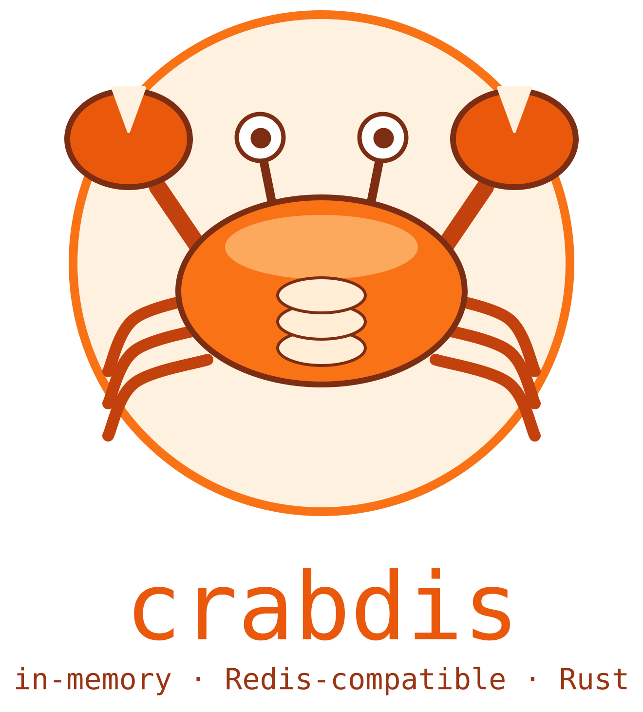
</p>

<p align="center">
  <b>A Redis 7.4-compatible in-memory data store, written from scratch in Rust.</b>
</p>

<p align="center">
  <a href="LICENSE"></a>
  <a href="https://github.com/Srizdebnath/crabdis/releases/latest"></a>
  
  <a href="https://github.com/Srizdebnath/crabdis/issues"></a>
</p>

crabdis speaks the Redis protocol (RESP2 and RESP3), so existing Redis clients and tools —
`redis-cli`, `redis-benchmark`, `redis-cli --cluster`, and client libraries — work against it
unchanged. It reads and writes the real Redis RDB format, so snapshots move between crabdis
and Redis in both directions.

> crabdis is an independent project. It is not affiliated with or endorsed by Redis Ltd.
> No Redis source code is included; Redis was used only as a behavioural reference.

## Install

Download the Linux x86_64 binary from the [latest release](https://github.com/Srizdebnath/crabdis/releases/latest), or build it from source as shown below.

## Quick start

```sh
cargo build --release
./target/release/crabdis                       # listens on 6379
./target/release/crabdis --port 7777 --appendonly yes
./target/release/crabdis /path/to/redis.conf --loglevel verbose
```

Then use any Redis client:

```sh
redis-cli -p 6379 set hello world
redis-cli -p 6379 get hello
```

Configuration uses the same directive names as `redis.conf`, either from a file or as
`--name value` arguments. `CONFIG GET` / `CONFIG SET` / `CONFIG REWRITE` are supported.

## What's implemented

251 commands (`COMMAND COUNT`), covering:

| Area | Details |
|---|---|
| Protocol | RESP2 and RESP3 (`HELLO`), inline commands, pipelining, RESP3 push |
| Data types | strings, bitmaps and `BITFIELD`, lists, hashes (including 7.4 per-field TTLs: `HEXPIRE`, `HTTL`, …), sets, sorted sets (skiplist), HyperLogLog (Redis-compatible dense/sparse encoding), geo, streams with consumer groups |
| Keyspace | 16 databases, lazy and active expiry, `SCAN` family, `SORT`, `OBJECT`, `DUMP`/`RESTORE` |
| Blocking | `BLPOP`, `BLMOVE`, `BZPOPMIN`, `BZMPOP`, `XREAD`/`XREADGROUP BLOCK`, `WAIT`, `CLIENT PAUSE`/`UNBLOCK` |
| Server | `MULTI`/`EXEC`/`WATCH`, pub/sub (channels, patterns, shard channels), keyspace notifications, client-side caching (`CLIENT TRACKING`), `INFO`, `SLOWLOG`, `LATENCY`, `MONITOR`, `MEMORY USAGE`, maxmemory with LRU/LFU/random/TTL eviction |
| Security | ACLs: users, SHA-256 passwords, command/category/key/channel permissions, selectors, `ACL LOG`, ACL files |
| Scripting | `EVAL`/`EVALSHA`/`SCRIPT` and `FUNCTION`/`FCALL` on Lua 5.1, with `cjson`, `cmsgpack`, `bit` and `struct`; `SCRIPT KILL`/`FUNCTION KILL` and `BUSY` replies |
| Persistence | RDB v12 (LZF, CRC64; loads ziplist/intset/listpack encodings), `SAVE`/`BGSAVE`/save points; multi-part AOF (manifest, base + incr files, RDB preamble, `appendfsync` policies, `BGREWRITEAOF`) |
| Replication | `REPLICAOF`, `PSYNC` full and partial resync with backlog, diskless loading, `WAIT`, `WAITAOF`, `FAILOVER`, `min-replicas-to-write` |
| Cluster | 16384 hash slots, hash tags, `MOVED`/`ASK`/`TRYAGAIN`/`CROSSSLOT`, all `CLUSTER` subcommands, gossip and failure detection, automatic and manual replica failover, `nodes.conf` |

## Verified against real Redis tooling

These were run with the official Redis 7.4 `redis-cli` and `redis-benchmark`:

- **Replication:** full sync, live streaming, read-only replicas, `WAIT`, partial resync after
  a dropped link, and a full resync after a promoted replica has diverged.
- **Cluster:** a 6-node cluster (3 masters, 3 replicas) created with `redis-cli --cluster create`;
  redirects and `-c` routing; after `kill -9` of a master its replica is promoted, and the
  restarted old master rejoins as a replica; `redis-cli --cluster check` reports no errors.
- **AOF recovery:** every data type, TTLs, hash-field TTLs, stream groups and function libraries
  survive `kill -9`, both before and after `BGREWRITEAOF`.
- **RDB compatibility:** Redis 7.4 loads crabdis snapshots, and crabdis loads Redis 7.4 snapshots.

## Performance

`redis-benchmark -n 200000 -c 50` on a 4-core machine, with the server and benchmark on the same host,
in requests per second:

| Command | crabdis | Redis 7.4 | crabdis `-P 16` | Redis 7.4 `-P 16` |
|---|---:|---:|---:|---:|
| SET | 53,490 | 66,600 | 327,869 | 527,705 |
| GET | 58,565 | 67,682 | 366,972 | 699,301 |
| INCR | 58,928 | 61,595 | 309,598 | 613,497 |
| LPUSH | 59,067 | 68,190 | 273,224 | 503,778 |
| HSET | 56,657 | 62,933 | 310,559 | 550,964 |
| ZADD | 57,787 | 64,495 | 308,642 | 475,059 |
| LRANGE_100 | 28,470 | 34,947 | 62,364 | 73,206 |
| MSET (10 keys) | 56,689 | 55,142 | 193,798 | 194,553 |

Without pipelining crabdis is within roughly 10–20% of Redis. With deep pipelining it is
slower, because it takes the store lock once per command; batching a pipeline under a single lock
is on the roadmap.

## Known differences from Redis

- The Lua debugger (`SCRIPT DEBUG YES|SYNC`) is not available.
- `redis.set_repl()` with AOF-only or replica-only targets propagates to both.
- The cluster bus uses crabdis's own binary format, so crabdis nodes cannot join a Redis cluster.
  Clients and `redis-cli --cluster` work normally.
- Sentinel and the Modules API are not implemented.

## Project layout

```
src/main.rs          startup, CLI/config parsing, listeners, signals
src/conn.rs          per-client connection loop
src/exec.rs          command dispatch: ACL, cluster redirects, MULTI, propagation
src/cmd/             command implementations, one file per area
src/resp.rs          RESP2/RESP3 parser and encoder
src/db.rs value.rs   keyspace and value types
src/dict.rs zset.rs stream.rs lp.rs   data structures and encodings
src/rdb.rs aof.rs    persistence
src/repl.rs          replication
src/cluster.rs       cluster state and bus
src/scripting.rs luaext.rs   Lua engine and libraries
src/acl.rs           access control
```

## Architecture

The diagrams below go from the big picture down to each subsystem. Each one names the
source file that implements it, so you can jump straight to the code.

**Contents**
1. [Big picture](#1-big-picture)
2. [Startup and shutdown](#2-startup-and-shutdown)
3. [Connections and the RESP protocol](#3-connections-and-the-resp-protocol)
4. [Command execution](#4-command-execution)
5. [Keyspace, expiry and eviction](#5-keyspace-expiry-and-eviction)
6. [Data structures](#6-data-structures)
7. [Blocking operations](#7-blocking-operations)
8. [Transactions](#8-transactions)
9. [Pub/Sub, notifications and client tracking](#9-pubsub-notifications-and-client-tracking)
10. [Security: AUTH and ACL](#10-security-auth-and-acl)
11. [Lua scripting and functions](#11-lua-scripting-and-functions)
12. [Persistence: RDB](#12-persistence-rdb)
13. [Persistence: AOF](#13-persistence-aof)
14. [Replication](#14-replication)
15. [Cluster](#15-cluster)
16. [Background cron](#16-background-cron)

### 1. Big picture

**1.1 System context.** What crabdis talks to.

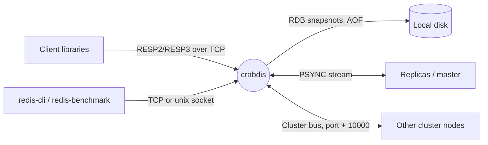

**1.2 Module map.** Who calls whom (`src/`).

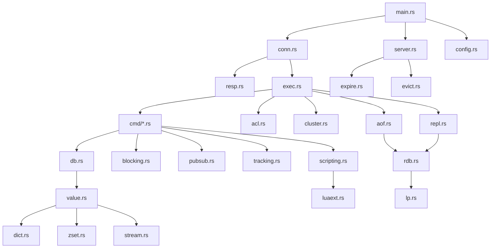

**1.3 Concurrency model.** Many tasks, one lock. All keyspace access happens while holding the
single `Mutex<Store>`, so commands run one at a time, as in Redis.

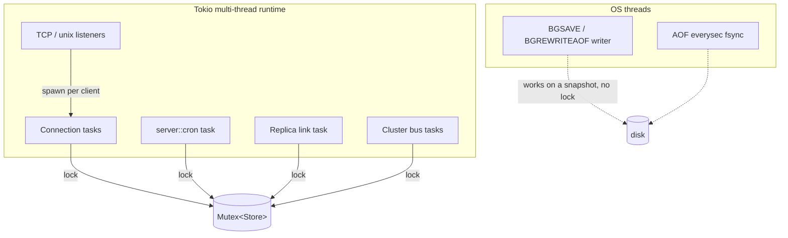

**1.4 Shared state.** The main structs in `server.rs`.

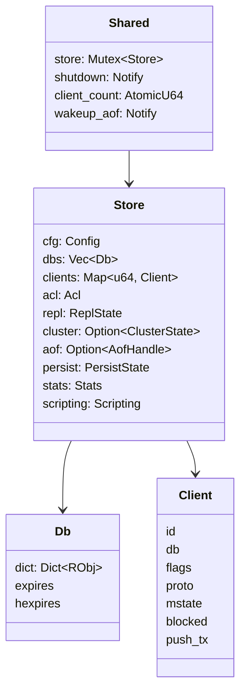

### 2. Startup and shutdown

**2.1 Boot sequence** (`main.rs`).

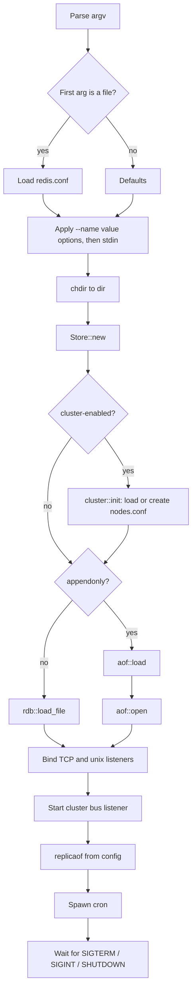

**2.2 Config sources.** Later sources override earlier ones.

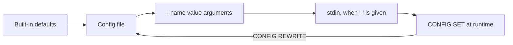

**2.3 Graceful shutdown.**

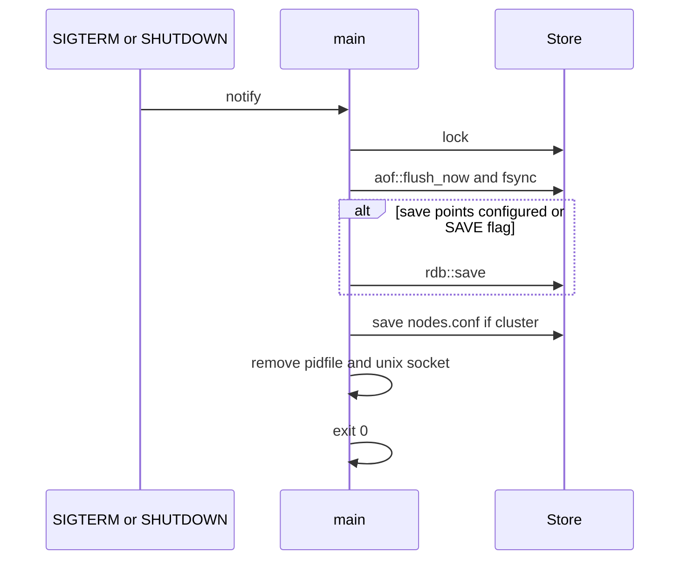

### 3. Connections and the RESP protocol

**3.1 Connection lifecycle** (`conn.rs`).

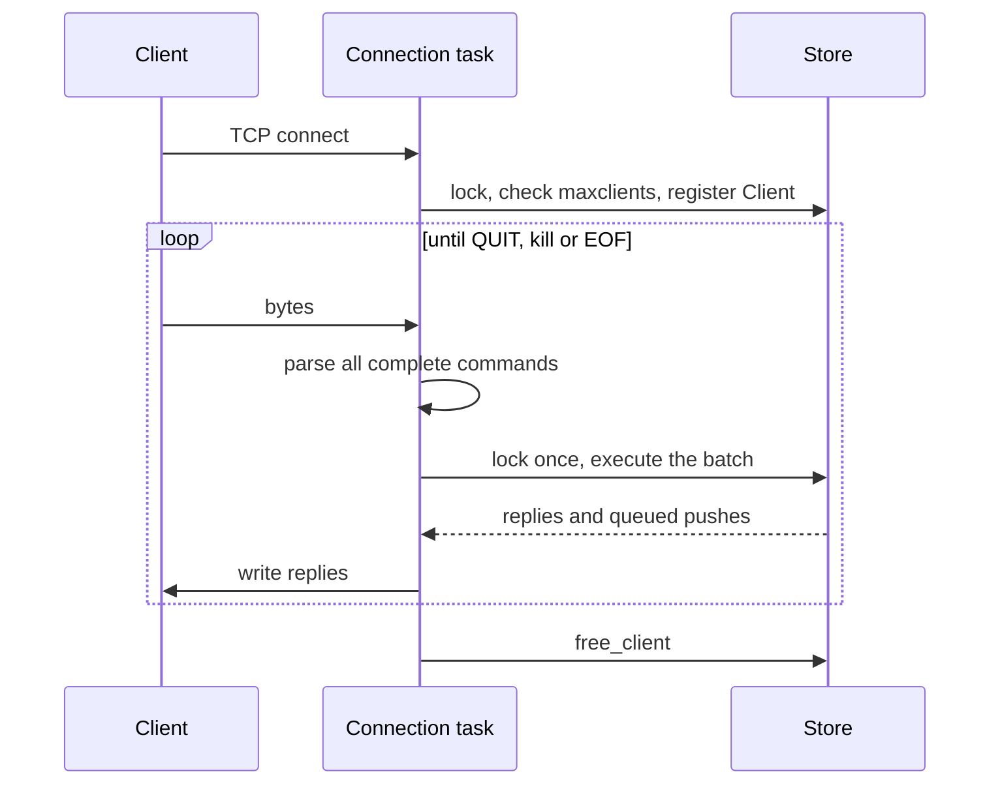

**3.2 Connection states.**

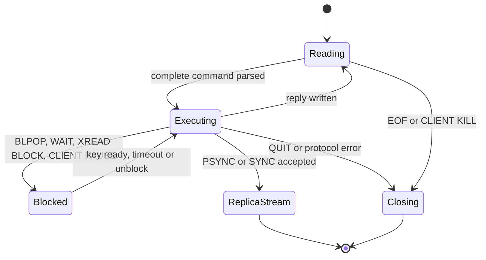

**3.3 Request parsing** (`resp.rs`).

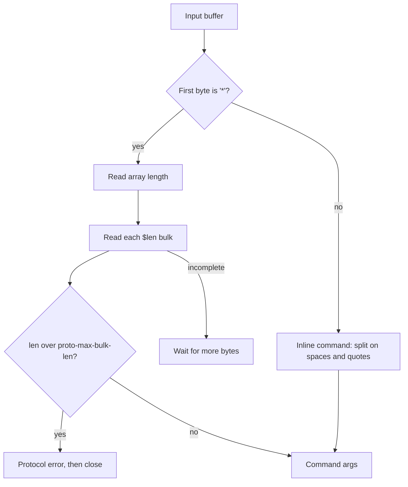

**3.4 Reply encoding.** One `Frame`, two wire formats.

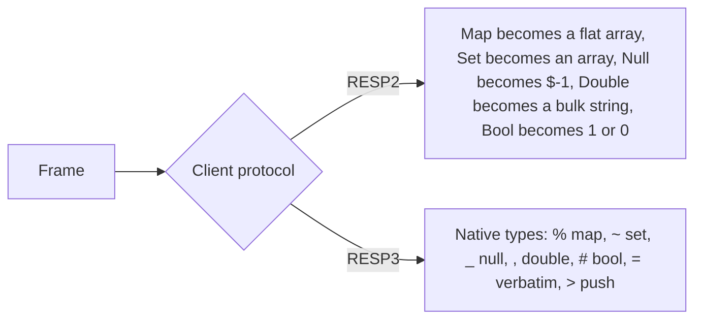

**3.5 Frame variants.**

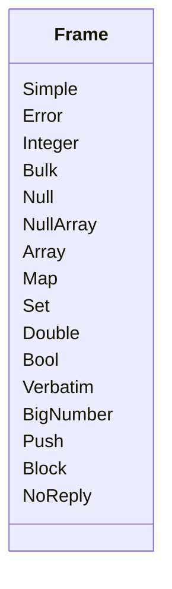

**3.6 Pipelining.** Every complete command in the buffer runs under a single lock acquisition.

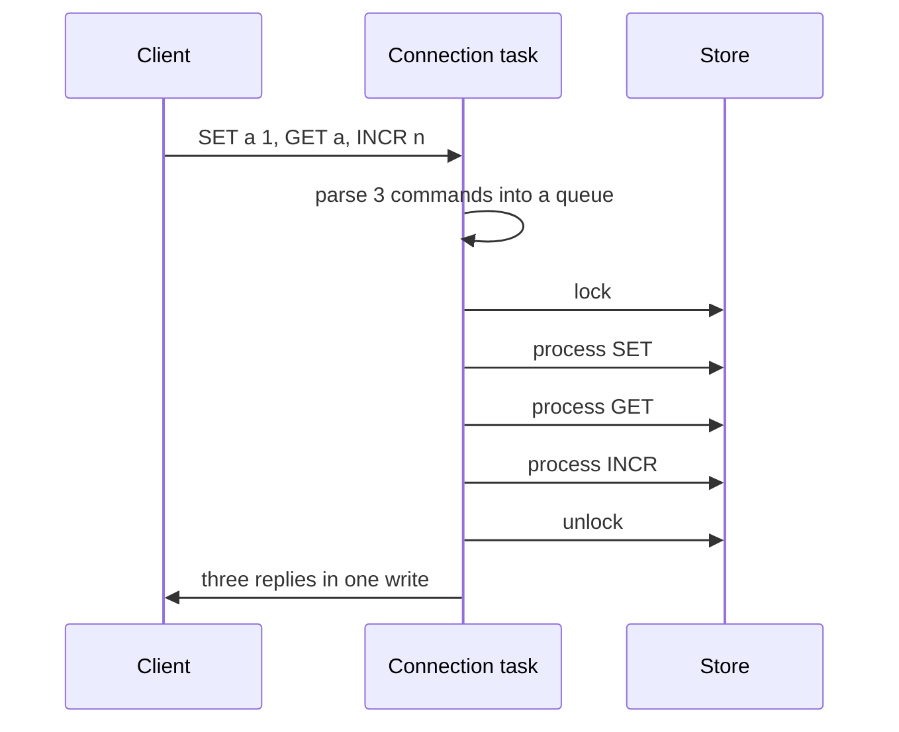

### 4. Command execution

**4.1 The `exec::process` pipeline.** Each command passes these checks in order.

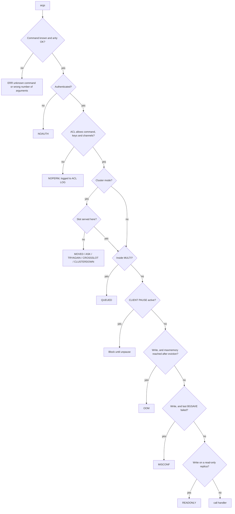

**4.2 `exec::call`.** Running a handler and recording what it did.

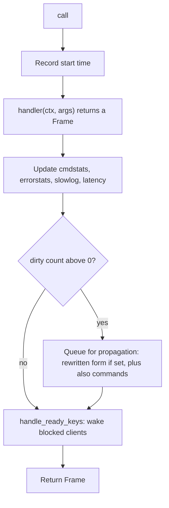

**4.3 Propagation to AOF and replicas.**

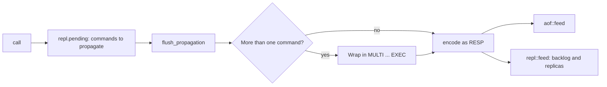

**4.4 Command table** (`cmd/mod.rs`).

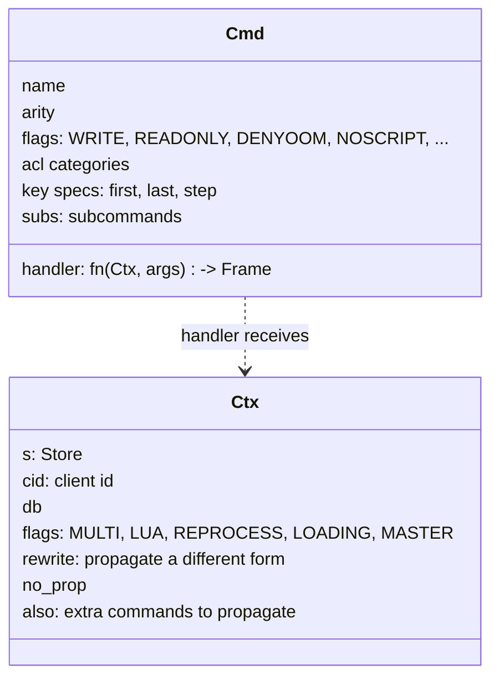

**4.5 Handler example: INCR.**

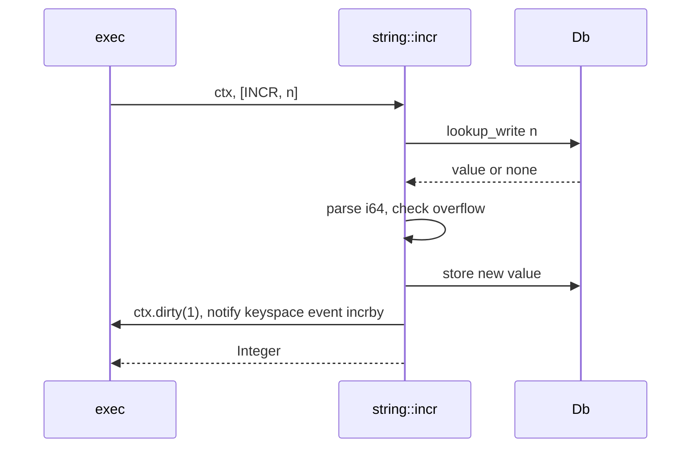

**4.6 Command rewriting for propagation.** Non-deterministic or relative commands are sent to the AOF and replicas in a deterministic form.

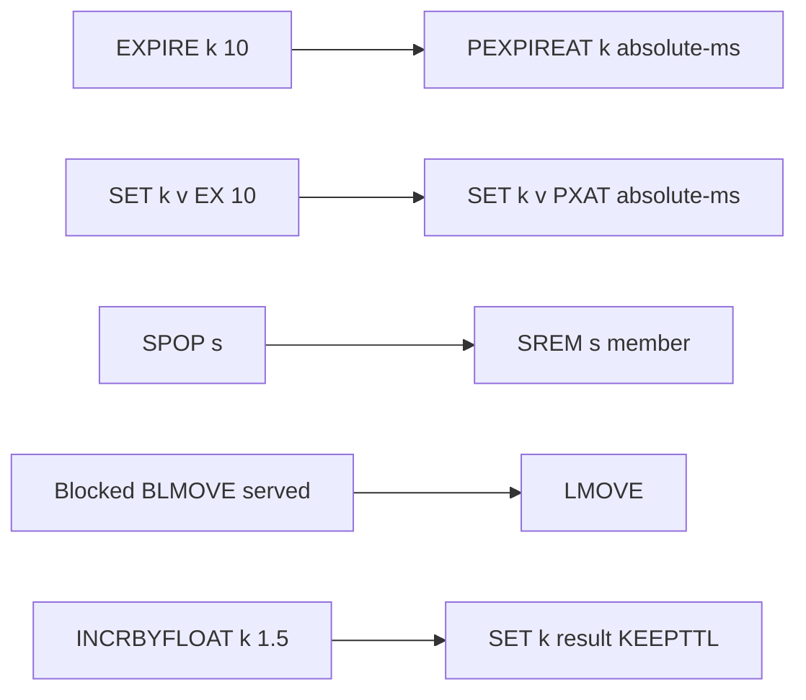

### 5. Keyspace, expiry and eviction

**5.1 Value types** (`value.rs`).

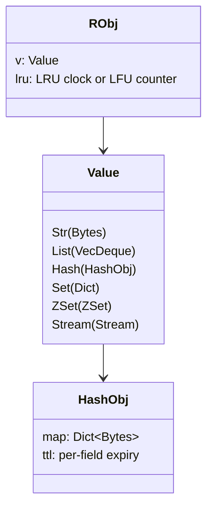

**5.2 Key lookup with lazy expiry** (`db.rs`).

```mermaid
flowchart TD
    A[lookup key] --> B{Has expire and it has passed?}
    B -->|no| F[Touch LRU or LFU, keyspace hit]
    B -->|yes| C{Running as replica?}
    C -->|yes| G["Report missing but keep the key, the master sends DEL"]
    C -->|no| D[Delete key, notify expired]
    D --> E[Propagate DEL or UNLINK]
    E --> H[keyspace miss]
    G --> H
    F --> I[Return value]
```

**5.3 Active expiry cycle** (`expire.rs`).

```mermaid
flowchart TD
    A[cron tick] --> B{Replica or paused?}
    B -->|yes| Z[skip]
    B -->|no| C[For each db]
    C --> D[Sample keys that have a TTL]
    D --> E[Delete the ones that expired]
    E --> F{"More than 10% of the sample expired, and under the time budget?"}
    F -->|yes| D
    F -->|no| G[Next db]
    G --> H[Expire hash fields whose TTL passed]
```

**5.4 Hash field expiry (Redis 7.4).**

```mermaid
flowchart LR
    H[HashObj] --> M["map: field to value"]
    H --> T[HashTtl]
    T --> BF["by_field: field to unix-ms"]
    T --> BT["by_time: ordered set of time and field"]
    DB[Db.hexpires] -->|"earliest field TTL per key"| H
```

**5.5 Eviction** (`evict.rs`).

```mermaid
flowchart TD
    A["used_memory over maxmemory?"] -->|no| Z[done]
    A -->|yes| B{policy}
    B -->|noeviction| E[Reject writes with OOM]
    B -->|allkeys-lru / volatile-lru| C[Sample keys, evict the longest idle]
    B -->|allkeys-lfu / volatile-lfu| D[Sample keys, evict the lowest LFU counter]
    B -->|allkeys-random / volatile-random| R[Evict a random key]
    B -->|volatile-ttl| T[Evict the nearest TTL]
    C --> F[Delete, propagate DEL, notify evicted]
    D --> F
    R --> F
    T --> F
    F --> A
```

**5.6 LRU and LFU in one 24-bit field.**

```mermaid
flowchart LR
    A[RObj.lru] --> B{maxmemory-policy}
    B -->|LRU| C["24-bit LRU clock in seconds; idle time = now - lru"]
    B -->|LFU| D["16 bits: last decrement time in minutes; 8 bits: log counter"]
    D --> E["Increment with probability 1 / (counter * lfu-log-factor + 1)"]
    D --> F["Decrement once per lfu-decay-time minutes"]
```

**5.7 Memory accounting** (`mem.rs`).

```mermaid
flowchart LR
    A[Every heap allocation] --> B[Counting global allocator]
    B --> C[System allocator]
    B --> D[(AtomicUsize used)]
    D --> E["INFO used_memory, maxmemory checks"]
```

### 6. Data structures

**6.1 Sorted set** (`zset.rs`). A skiplist for ordered range queries and a dict for O(1) score lookup.

```mermaid
flowchart LR
    Z[ZSet] --> D["dict: member to score"]
    Z --> S[skiplist ordered by score, then member]
    S --> L4[level 4: sparse express lane]
    L4 --> L1[level 1: every element]
    L1 --> R["rank and span, for ZRANK and ZRANGE by index"]
```

**6.2 Stream layout** (`stream.rs`).

```mermaid
classDiagram
    class Stream {
        nodes: BTreeMap of entry nodes
        length
        last_id
        first_id
        max_deleted_id
        entries_added
        groups: BTreeMap
    }
    class Group {
        last_id
        entries_read
        pel: id to PendingEntry
        consumers
    }
    class Consumer {
        seen_time
        active_time
        pel: ids
    }
    class PendingEntry {
        consumer
        delivery_time
        delivery_count
    }
    Stream --> Group
    Group --> Consumer
    Group --> PendingEntry
```

**6.3 Consumer group flow.**

```mermaid
sequenceDiagram
    participant P as Producer
    participant S as Stream
    participant G as Group g
    participant C as Consumer c1
    P->>S: XADD s * field value
    C->>G: XREADGROUP GROUP g c1 STREAMS s >
    G->>G: advance last_id, add to PEL with owner c1
    G-->>C: entries
    C->>G: XACK s g id
    G->>G: remove from PEL
    Note over G: Unacked entries can be taken over with XCLAIM or XAUTOCLAIM
```

**6.4 Stream ID generation.**

```mermaid
flowchart TD
    A[XADD id] --> B{id form}
    B -->|"*"| C["ms = now; if ms is not after last_id.ms, use last ms and seq+1"]
    B -->|"ms-*"| D[seq = next for that ms]
    B -->|explicit| E{"greater than last_id?"}
    E -->|no| X[ERR equal or smaller than the target stream top item]
    E -->|yes| F[accept]
    C --> F
    D --> F
```

**6.5 HyperLogLog encodings.**

```mermaid
stateDiagram-v2
    [*] --> Sparse: PFADD on a new key
    Sparse --> Sparse: registers fit in hll-sparse-max-bytes
    Sparse --> Dense: register value over 32 or size limit reached
    Dense --> Dense: 16384 registers of 6 bits
```

**6.6 Listpack and legacy encodings** (`lp.rs`). Used only when reading and writing RDB.

```mermaid
flowchart LR
    R[RDB value] --> T{type byte}
    T -->|listpack types| LP[lp::decode]
    T -->|ziplist types, older RDB| ZL[lp::decode_ziplist]
    T -->|intset| IS[lp::decode_intset]
    LP --> V[In-memory Value]
    ZL --> V
    IS --> V
```

### 7. Blocking operations

**7.1 BLPOP served by a later LPUSH** (`blocking.rs`).

```mermaid
sequenceDiagram
    participant A as Client A
    participant B as Client B
    participant S as Store
    A->>S: BLPOP q 0
    S->>S: q is empty, register A as blocked on q
    S-->>A: no reply yet, task awaits oneshot
    B->>S: LPUSH q job
    S->>S: signal q as ready
    S->>S: handle_ready_keys: re-run BLPOP for A
    S-->>A: q, job through oneshot
    S->>S: propagate LPUSH, then LPOP
    S-->>B: 1
```

**7.2 Blocked client outcomes.**

```mermaid
stateDiagram-v2
    [*] --> Blocked
    Blocked --> Served: key became ready and command succeeded
    Blocked --> TimedOut: deadline reached, timeout reply such as nil
    Blocked --> Unblocked: CLIENT UNBLOCK, TIMEOUT or ERROR
    Blocked --> Killed: connection closed
    Blocked --> Redirected: cluster slot moved away, MOVED
    Served --> [*]
    TimedOut --> [*]
    Unblocked --> [*]
    Killed --> [*]
    Redirected --> [*]
```

**7.3 Kinds of blocking.**

```mermaid
flowchart LR
    B[BlockSpec] --> K["Keys: BLPOP, BLMOVE, BZPOPMIN, BZMPOP, XREAD, XREADGROUP"]
    B --> W["Wait: WAIT, WAITAOF for replica acks"]
    B --> P["Pause: CLIENT PAUSE"]
    K --> R[Woken by handle_ready_keys]
    W --> A[Woken by REPLCONF ACK]
    P --> U[Woken by unpause]
```

### 8. Transactions

**8.1 MULTI/EXEC state** (`cmd/multi.rs`).

```mermaid
stateDiagram-v2
    [*] --> Normal
    Normal --> Queuing: MULTI
    Queuing --> Queuing: command, QUEUED
    Queuing --> Dirty: syntax or arity error while queuing
    Dirty --> Normal: EXEC returns EXECABORT
    Queuing --> Normal: DISCARD
    Queuing --> Normal: EXEC, a watched key changed, returns nil
    Queuing --> Normal: EXEC runs all commands atomically
```

**8.2 WATCH invalidation.**

```mermaid
sequenceDiagram
    participant A as Client A
    participant B as Client B
    participant S as Store
    A->>S: WATCH balance
    A->>S: MULTI
    A->>S: DECRBY balance 10
    B->>S: SET balance 0
    S->>S: touch balance, mark A dirty CAS
    A->>S: EXEC
    S-->>A: nil, transaction not executed
```

**8.3 EXEC propagation.**

```mermaid
flowchart LR
    E[EXEC] --> R[Run queued commands with CTX_MULTI]
    R --> P[Collect only the commands that wrote]
    P --> W[Wrap as MULTI ... EXEC]
    W --> A[AOF]
    W --> RP[Replicas]
```

### 9. Pub/Sub, notifications and client tracking

**9.1 PUBLISH fan-out** (`pubsub.rs`).

```mermaid
sequenceDiagram
    participant P as Publisher
    participant S as Store
    participant Sub1 as Subscriber to news
    participant Sub2 as Subscriber to n*
    P->>S: PUBLISH news hello
    S->>S: look up exact channel subscribers
    S->>Sub1: push message news hello
    S->>S: match patterns
    S->>Sub2: push pmessage n* news hello
    S-->>P: 2 receivers
```

**9.2 How pushes reach a socket.**

```mermaid
flowchart LR
    A[Any command] -->|"Frame::Push"| B["client.push_tx (unbounded mpsc)"]
    B --> C[Connection task drains after each command]
    C --> D[encode RESP2 array or RESP3 push]
    D --> E[socket]
```

**9.3 Keyspace notifications.**

```mermaid
flowchart TD
    A["Handler calls notify(type, event, key)"] --> B{"notify-keyspace-events enables this class?"}
    B -->|no| Z[drop]
    B -->|K| C["PUBLISH __keyspace@db__:key event"]
    B -->|E| D["PUBLISH __keyevent@db__:event key"]
```

**9.4 Sharded pub/sub in a cluster.**

```mermaid
sequenceDiagram
    participant Cl as Client
    participant N as Node owning the slot of ch
    participant R as Its replicas
    Cl->>N: SPUBLISH ch msg
    N->>N: slot check, MOVED if not owner
    N->>N: deliver to local SSUBSCRIBE clients
    N->>R: PUBLISHSHARD on the cluster bus
```

**9.5 Client-side caching** (`tracking.rs`).

```mermaid
sequenceDiagram
    participant A as Client A
    participant S as Store
    participant B as Client B
    A->>S: CLIENT TRACKING ON
    A->>S: GET user
    S->>S: remember A read user
    B->>S: SET user new
    S->>A: invalidate user
    Note over S: BCAST mode tracks key prefixes instead of keys that were read
```

**9.6 Tracking modes.**

```mermaid
flowchart TD
    T[CLIENT TRACKING ON] --> M{mode}
    M -->|default| D[Server remembers each key the client read]
    M -->|BCAST PREFIX p| B[Invalidate any key that starts with p]
    M -->|OPTIN / OPTOUT| O[CLIENT CACHING yes or no per command]
    T --> R{REDIRECT id?}
    R -->|yes| RR[Invalidations go to another connection]
    R -->|no, RESP3| P[Push on the same connection]
```

### 10. Security: AUTH and ACL

**10.1 Authentication.**

```mermaid
sequenceDiagram
    participant Cl as Client
    participant S as Store
    participant A as Acl
    Cl->>S: AUTH alice secret, or HELLO 3 AUTH alice secret
    S->>A: check_credentials
    A->>A: SHA-256 of password compared with the stored hashes
    alt match and user is on
        A-->>S: ok
        S-->>Cl: OK
    else
        A->>A: add ACL LOG entry, reason auth
        S-->>Cl: WRONGPASS
    end
```

**10.2 Permission check** (`acl.rs`).

```mermaid
flowchart TD
    A[Command from user] --> B{User has allcommands or the command bit?}
    B -->|no| C{First-arg rule allows it, for example CONFIG GET?}
    C -->|no| X[NOPERM command]
    B -->|yes| D
    C -->|yes| D{"Every key matches a pattern with the right R/W permission?"}
    D -->|no| Y[NOPERM key]
    D -->|yes| E{"Every channel matches a channel pattern?"}
    E -->|no| Z[NOPERM channel]
    E -->|yes| OK[allowed]
    X --> S{"Another selector, written in (...), allows it?"}
    Y --> S
    Z --> S
    S -->|yes| OK
    S -->|no| LOG[Log to ACL LOG and reject]
```

**10.3 ACL model.**

```mermaid
classDiagram
    class Acl {
        users: BTreeMap
        log: VecDeque~LogEntry~
    }
    class User {
        name
        enabled
        nopass
        passwords: SHA-256 hashes
        root: Selector
        selectors: Vec~Selector~
    }
    class Selector {
        allowed command bits
        firstargs
        keys: Vec~KeyPattern~
        channels
    }
    class KeyPattern {
        flags: R, W or RW
        pattern
    }
    Acl --> User
    User --> Selector
    Selector --> KeyPattern
```

**10.4 Where ACL rules are stored.**

```mermaid
flowchart LR
    A["user lines in redis.conf"] --> U[Acl.users]
    B[aclfile] -->|ACL LOAD| U
    C[ACL SETUSER] --> U
    U -->|ACL SAVE| B
    U -->|CONFIG REWRITE| A
    R[requirepass] --> D[default user password]
```

### 11. Lua scripting and functions

**11.1 EVAL** (`scripting.rs`).

```mermaid
sequenceDiagram
    participant Cl as Client
    participant S as scripting
    participant L as Lua VM
    participant E as exec_internal
    Cl->>S: EVAL body 1 k v
    S->>S: sha1 of body, compile and cache
    S->>L: set KEYS and ARGV, run with xpcall
    L->>S: redis.call SET k v
    S->>E: run as the Lua pseudo client, CTX_LUA
    E-->>S: Frame
    S-->>L: converted Lua value
    L-->>S: return value
    S-->>Cl: converted RESP reply
    S->>S: propagate the writes wrapped in MULTI/EXEC
```

**11.2 Checks inside `redis.call`.**

```mermaid
flowchart TD
    A["redis.call(cmd, ...)"] --> B{Command exists?}
    B -->|no| X1[Unknown Redis command called from script]
    B -->|yes| C{Flagged noscript, such as MULTI or SUBSCRIBE?}
    C -->|yes| X2[This Redis command is not allowed from script]
    C -->|no| D{"Write in an EVAL_RO / FCALL_RO / no-writes script?"}
    D -->|yes| X3[Write commands are not allowed from read-only scripts]
    D -->|no| E{ACL allows it for the calling user?}
    E -->|no| X4[NOPERM]
    E -->|no problem| F{"Cluster: key in this node's slots?"}
    F -->|no| X5[Script attempted to access a non local key]
    F -->|yes| G[exec_internal]
    X1 --> P{call or pcall?}
    X2 --> P
    X3 --> P
    X4 --> P
    X5 --> P
    P -->|call| R[Raise a Lua error]
    P -->|pcall| T[Return an error table]
```

**11.3 Converting between Lua and RESP.**

```mermaid
flowchart LR
    subgraph RESP to Lua
        I[Integer] --> LI[number]
        B[Bulk] --> LS[string]
        N[Null] --> LF[false]
        A[Array] --> LT[table]
        ST[Status] --> LO["table with an ok field"]
        ER[Error] --> LE["table with an err field"]
    end
    subgraph Lua to RESP
        n2[number] --> I2["Integer, truncated"]
        s2[string] --> B2[Bulk]
        t2[table] --> A2["Array, stops at the first nil"]
        f2[false] --> N2[Null]
        tr[true] --> I3[Integer 1]
    end
```

**11.4 A long-running script.** The store stays locked, so other connections answer without taking the lock.

```mermaid
sequenceDiagram
    participant A as Client A
    participant T as Connection B
    participant S as Script in Lua VM
    A->>S: EVAL infinite loop
    Note over S: runs longer than busy-reply-threshold
    T->>T: busy_reply checks atomics, no lock needed
    T-->>T: BUSY Redis is busy running a script
    T->>S: SCRIPT KILL sets the KILL flag
    S->>S: Lua hook sees KILL and raises an error
    S-->>A: ERR Script killed by user with SCRIPT KILL
```

**11.5 Functions.**

```mermaid
sequenceDiagram
    participant Cl as Client
    participant F as Function engine
    participant L as Functions Lua VM
    Cl->>F: FUNCTION LOAD with shebang lua name=lib
    F->>F: parse the shebang line
    F->>L: run the library code in a restricted environment
    L->>F: redis.register_function name and callback
    F->>F: check names are unique, store the library
    F-->>Cl: lib
    Cl->>F: FCALL name 1 key arg
    F->>L: call the callback with keys and args
    L-->>Cl: reply
```

**11.6 Sandbox.**

```mermaid
flowchart TD
    G[Script globals] --> P[Read-only proxy table]
    P -->|read a missing global| E1[Script attempted to access nonexistent global variable]
    P -->|assign a global| E2[Attempt to modify a readonly table]
    P --> LIBS["Available: redis, cjson, cmsgpack, bit, struct, string, table, math"]
    P --> NO["Removed: io, os except os.clock, loadfile, dofile"]
```

**11.7 Script replication.**

```mermaid
flowchart LR
    S[Script runs] --> W[Each write that redis.call makes]
    W --> Q[Queued as an effect]
    Q --> M[MULTI ... EXEC around the effects]
    M --> A[AOF and replicas get the commands, not the script]
```

### 12. Persistence: RDB

**12.1 File layout** (`rdb.rs`, RDB version 12).

```mermaid
flowchart LR
    A["'REDIS0012'"] --> B["AUX fields: redis-ver, ctime, used-mem, repl info"]
    B --> F[FUNCTION2 libraries]
    F --> C["SELECTDB n, RESIZEDB"]
    C --> D["Entries: optional EXPIRETIME_MS, LRU/LFU, type, key, value"]
    D --> C
    D --> E["EOF 0xFF"]
    E --> G[CRC64 checksum, 8 bytes]
```

**12.2 Value encodings written.**

```mermaid
flowchart TD
    V[Value] --> S[String: int encoding, LZF if it shrinks, or raw]
    V --> L[List: QUICKLIST_2 of listpacks]
    V --> H{Hash has field TTLs?}
    H -->|no| H1[HASH]
    H -->|yes| H2[HASH_METADATA with per-field expiry]
    V --> Z["ZSET_2: binary double scores"]
    V --> T[SET]
    V --> X["STREAM_LISTPACKS_3: entries, groups, PEL, consumers"]
```

**12.3 BGSAVE.**

```mermaid
sequenceDiagram
    participant C as Client or cron
    participant S as Store, locked
    participant W as Writer thread
    participant D as Disk
    C->>S: BGSAVE
    S->>S: snapshot: clone the dbs, which shares Bytes buffers
    S-->>C: Background saving started
    S->>W: spawn with the snapshot
    W->>W: serialize, LZF, CRC64
    W->>D: write temp-pid.rdb, fsync
    W->>D: rename to dump.rdb
    W->>S: lock, set lastsave, dirty count, status ok
```

**12.4 Automatic save points.**

```mermaid
flowchart TD
    A[cron] --> B{BGSAVE or rewrite already running?}
    B -->|yes| Z[wait]
    B -->|no| C{"Any save rule 'secs changes' met?"}
    C -->|no| Z
    C -->|yes| D{"Last save failed under 5s ago?"}
    D -->|yes| Z
    D -->|no| E[bgsave]
```

**12.5 Loading at startup.**

```mermaid
flowchart TD
    A[dump.rdb exists?] -->|no| Z[empty dataset]
    A -->|yes| B[Check magic and version]
    B --> C[Read opcodes in a loop]
    C --> D{Key already expired?}
    D -->|"yes, master"| E[skip and count expired]
    D -->|no| F[insert with TTL and LRU/LFU]
    C --> G[EOF]
    G --> H{CRC64 matches?}
    H -->|no| X[Refuse to start]
    H -->|yes| I[Install dbs and functions]
```

**12.6 DUMP and RESTORE.**

```mermaid
flowchart LR
    A[DUMP key] --> B[RDB value encoding]
    B --> C["+ 2-byte RDB version"]
    C --> D["+ CRC64"]
    D --> E[payload]
    E --> F["RESTORE key ttl payload"]
    F --> G{version and CRC ok?}
    G -->|yes| H[insert]
    G -->|no| X[ERR DUMP payload version or checksum are wrong]
```

### 13. Persistence: AOF

**13.1 Multi-part layout** (`aof.rs`, Redis 7 format).

```mermaid
flowchart TD
    D["appendonlydir/"] --> M[appendonly.aof.manifest]
    M -->|"type b"| B["appendonly.aof.N.base.rdb, or .aof without preamble"]
    M -->|"type i"| I1[appendonly.aof.N.incr.aof]
    M -->|"type i"| I2["appendonly.aof.N+1.incr.aof"]
    M -->|"type h"| H[history files, deleted after a rewrite]
```

**13.2 Write path and fsync policies.**

```mermaid
flowchart TD
    A[flush_propagation] --> B[aof::feed]
    B --> C{Need SELECT?}
    C -->|db changed| D[prepend SELECT db]
    C -->|no| E
    D --> E[append RESP to the current incr file]
    E --> F{appendfsync}
    F -->|always| G[fsync before replying]
    F -->|everysec| H[fsync thread, once per second if dirty]
    F -->|no| I[leave it to the OS]
```

**13.3 BGREWRITEAOF.**

```mermaid
sequenceDiagram
    participant S as Store
    participant W as Rewrite thread
    participant D as appendonlydir
    S->>S: snapshot the dataset
    S->>D: open new incr file N+1, new writes go there
    S->>W: spawn with the snapshot
    W->>D: write base N+1 as RDB preamble or as commands
    W->>S: lock
    S->>D: write new manifest, base N+1 plus incr N+1
    S->>D: mark the old base and incrs as history, then delete them
```

**13.4 Loading the AOF.**

```mermaid
flowchart TD
    A[Read manifest] --> B[Load base]
    B --> C{"Base starts with 'REDIS'?"}
    C -->|yes| D[RDB loader]
    C -->|no| E[Replay commands]
    D --> F[Replay each incr file in order]
    E --> F
    F --> G{Truncated last command?}
    G -->|"yes, aof-load-truncated yes"| H[Truncate to the last valid command, warn]
    G -->|"yes, otherwise"| X[Refuse to start]
    G -->|no| OK[ready]
    H --> OK
```

**13.5 Replaying commands.**

```mermaid
sequenceDiagram
    participant L as aof::load
    participant P as AOF pseudo client
    participant E as exec_internal
    L->>L: parse RESP commands
    loop each command
        alt MULTI
            L->>L: start buffering
        else EXEC
            L->>E: run the buffered commands
        else other
            L->>E: run with CTX_LOADING
        end
    end
    Note over L: A MULTI without EXEC at end of file is dropped as incomplete
```

### 14. Replication

**14.1 Replica handshake** (`repl.rs`).

```mermaid
sequenceDiagram
    participant R as Replica
    participant M as Master
    R->>M: PING
    M-->>R: PONG
    R->>M: AUTH masteruser masterauth, if set
    R->>M: REPLCONF listening-port 6380
    R->>M: REPLCONF capa eof capa psync2
    R->>M: PSYNC replid offset
    alt can continue
        M-->>R: +CONTINUE replid
        M->>R: backlog from offset onwards
    else full sync
        M-->>R: +FULLRESYNC replid offset
        M->>R: "$len" then the RDB bytes
        R->>R: flush, load the RDB
    end
    loop forever
        M->>R: command stream
        R->>M: REPLCONF ACK offset, every second
    end
```

**14.2 Choosing partial or full sync.**

```mermaid
flowchart TD
    A["PSYNC replid offset"] --> B{"replid equals ours, or replid2 with offset up to second_offset?"}
    B -->|no| F[FULLRESYNC]
    B -->|yes| C{"offset still inside the backlog?"}
    C -->|no| F
    C -->|yes| P[CONTINUE, send the missing bytes]
```

**14.3 Replication backlog.**

```mermaid
flowchart LR
    W[Write commands] --> B["Backlog ring buffer, repl-backlog-size"]
    B --> O1["backlog_off: oldest byte kept"]
    B --> O2["master_repl_offset: newest byte"]
    B --> R1[Replica A offset]
    B --> R2[Replica B offset]
```

**14.4 Replica link states.**

```mermaid
stateDiagram-v2
    [*] --> Connect: REPLICAOF host port
    Connect --> Handshake: TCP connected
    Handshake --> Transfer: FULLRESYNC
    Handshake --> Connected: CONTINUE
    Transfer --> Connected: RDB loaded
    Connected --> Connect: link lost, retry
    Handshake --> Connect: error
    Connected --> [*]: REPLICAOF NO ONE
```

**14.5 Applying the master's stream.**

```mermaid
flowchart LR
    M[Master socket] --> P[Parse RESP]
    P --> E["exec as master pseudo client, CTX_MASTER"]
    E --> D[Dataset]
    P --> RB[Raw bytes copied to our own backlog]
    RB --> SR[Our sub-replicas, chained replication]
    P --> OFF[Advance processed offset]
```

**14.6 WAIT.**

```mermaid
sequenceDiagram
    participant C as Client
    participant M as Master
    participant R as Replica
    C->>M: SET k v
    C->>M: WAIT 1 1000
    M->>M: block C, target = current offset
    M->>R: REPLCONF GETACK *
    R-->>M: REPLCONF ACK offset
    M->>M: count replicas at or past the target
    M-->>C: 1
```

**14.7 Write safety on the master.**

```mermaid
flowchart TD
    A[Write command] --> B{"min-replicas-to-write over 0?"}
    B -->|no| OK[run]
    B -->|yes| C{"Replicas with lag up to min-replicas-max-lag, enough of them?"}
    C -->|yes| OK
    C -->|no| X[NOREPLICAS Not enough good replicas to write]
```

**14.8 FAILOVER.**

```mermaid
sequenceDiagram
    participant Cl as Client
    participant M as Master
    participant R as Replica
    Cl->>M: FAILOVER TO host port
    M->>M: pause writes
    M->>M: wait until the replica offset equals ours
    M->>R: PSYNC with the FAILOVER argument
    R->>R: become master
    M->>M: become a replica of R
    M->>M: unpause
```

**14.9 Replication IDs over a promotion.**

```mermaid
flowchart LR
    A["replid = A"] -->|"REPLICAOF NO ONE"| B["replid2 = A, second_offset = offset+1, new replid = B"]
    B --> C[Old sibling replicas can still partial-sync using A]
```

### 15. Cluster

**15.1 Key to slot** (`cluster.rs`).

```mermaid
flowchart TD
    K[key] --> A{"Contains '{' and a later '}' with something between?"}
    A -->|yes| B[Hash only the text inside the braces]
    A -->|no| C[Hash the whole key]
    B --> D["CRC16-XMODEM mod 16384"]
    C --> D
    D --> S[slot]
```

**15.2 Redirect decision.**

```mermaid
flowchart TD
    A[Command with keys] --> B{All keys in one slot?}
    B -->|no| X1[CROSSSLOT]
    B -->|yes| C{Cluster state ok?}
    C -->|no| X2[CLUSTERDOWN, unless reads are allowed when down]
    C -->|yes| D{Slot owned by me?}
    D -->|yes| E{"Slot migrating, and some keys missing?"}
    E -->|"yes, all missing"| X3[ASK target]
    E -->|"yes, some missing"| X4[TRYAGAIN]
    E -->|no| RUN[run]
    D -->|no| F{"Importing and client sent ASKING?"}
    F -->|yes| RUN
    F -->|no| G{"I'm a replica of the owner, READONLY set and it's a read?"}
    G -->|yes| RUN
    G -->|no| X5[MOVED slot owner]
```

**15.3 Cluster state.**

```mermaid
classDiagram
    class ClusterState {
        myself: node id
        current_epoch
        last_vote_epoch
        nodes: Map~id, Node~
        slots: 16384 owners
        migrating: slot to node
        importing: slot to node
        state_ok
    }
    class Node {
        id
        ip, port, cport
        flags: MYSELF MASTER SLAVE PFAIL FAIL HANDSHAKE
        master
        config_epoch
        slots bitmap
        link
        ping_sent, pong_recv
        fail_reports
        repl_offset
    }
    ClusterState --> Node
```

**15.4 Bus message types.**

```mermaid
flowchart LR
    BUS[Cluster bus frame: magic RCmb, type, sender, epochs, slots, gossip] --> T{type}
    T --> PING[PING / PONG / MEET: heartbeat plus gossip]
    T --> FAIL[FAIL: node declared failed]
    T --> PUB[PUBLISH / PUBLISHSHARD]
    T --> AR[AUTH_REQ / AUTH_ACK: failover votes]
    T --> UP[UPDATE: newer slot config]
    T --> MF[MFSTART: manual failover]
```

**15.5 Joining with CLUSTER MEET.**

```mermaid
sequenceDiagram
    participant A as Node A
    participant B as Node B
    participant C as Node C, known to B
    A->>A: CLUSTER MEET B-ip B-port, add B in HANDSHAKE
    A->>B: MEET
    B->>B: add A
    B-->>A: PONG with B's real id
    A->>A: rename the handshake node to B's id
    B->>A: PING with gossip about C
    A->>C: MEET via gossip, A now knows the whole cluster
```

**15.6 Failure detection.**

```mermaid
sequenceDiagram
    participant A as Master A
    participant B as Master B
    participant X as Node X, down
    A->>X: PING
    Note over A: no PONG within node-timeout
    A->>A: mark X PFAIL
    A->>B: gossip: X is PFAIL
    B->>B: also sees X as PFAIL, sends failure report
    A->>A: reports from a majority of masters
    A->>A: mark X FAIL
    A->>B: FAIL X, broadcast to all
```

**15.7 Node flags.**

```mermaid
stateDiagram-v2
    [*] --> Handshake: MEET or gossip
    Handshake --> Online: first PONG
    Online --> PFAIL: no PONG within node-timeout
    PFAIL --> Online: PONG received
    PFAIL --> FAIL: majority of masters agree
    FAIL --> Online: PONG, if a replica or a master without slots
    FAIL --> Online: PONG after 2x node-timeout, if a master still holds slots
    Handshake --> [*]: handshake timed out
```

**15.8 Automatic replica failover.**

```mermaid
sequenceDiagram
    participant R as Replica of X
    participant M1 as Master 1
    participant M2 as Master 2
    Note over R: master X is FAIL
    R->>R: wait a delay that grows with rank, more lag means later
    R->>R: current_epoch + 1
    R->>M1: AUTH_REQ epoch
    R->>M2: AUTH_REQ epoch
    M1->>M1: not voted in this epoch, X is FAIL
    M1-->>R: AUTH_ACK
    M2-->>R: AUTH_ACK
    R->>R: majority reached, take over X's slots, config_epoch = epoch
    R->>M1: PONG with new slot ownership
    R->>M2: PONG with new slot ownership
```

**15.9 Manual failover.**

```mermaid
flowchart TD
    A[CLUSTER FAILOVER on a replica] --> B{option}
    B -->|default| C[MFSTART to the master]
    C --> D[Master pauses clients, sends its offset]
    D --> E[Replica catches up to the offset]
    E --> F[Election with AUTH_REQ]
    B -->|FORCE| F
    B -->|TAKEOVER| G[Bump epoch and take the slots without a vote]
    F --> H[New master]
    G --> H
```

**15.10 Config epochs resolve conflicts.**

```mermaid
flowchart TD
    A[Gossip says node N owns slot s] --> B{"N's config_epoch higher than the current owner's?"}
    B -->|yes| C[Reassign s to N]
    B -->|no| D[Keep, and send UPDATE to N if ours is newer]
    C --> E{Was s mine?}
    E -->|yes, now lost all slots| F[Become a replica of N]
```

**15.11 Resharding a slot.**

```mermaid
sequenceDiagram
    participant T as Tool, redis-cli --cluster
    participant S as Source
    participant D as Destination
    T->>D: CLUSTER SETSLOT s IMPORTING source-id
    T->>S: CLUSTER SETSLOT s MIGRATING dest-id
    loop until the slot is empty
        T->>S: CLUSTER GETKEYSINSLOT s 100
        T->>S: MIGRATE dest-ip dest-port "" 0 timeout KEYS ...
        S->>D: RESTORE-ASKING
    end
    T->>D: CLUSTER SETSLOT s NODE dest-id
    T->>S: CLUSTER SETSLOT s NODE dest-id
    Note over S,D: Meanwhile clients get ASK for keys already moved
```

**15.12 nodes.conf.**

```mermaid
flowchart LR
    S[Cluster state changes] --> T[todo_save flag]
    T --> W[Write nodes.conf: one line per node, then vars currentEpoch lastVoteEpoch]
    W --> L[Loaded at boot by cluster::init]
```

**15.13 Creating a cluster with redis-cli.**

```mermaid
sequenceDiagram
    participant T as redis-cli --cluster create
    participant N as Each node
    T->>N: CLUSTER INFO, INFO: check empty and cluster-enabled
    T->>N: CLUSTER ADDSLOTSRANGE for masters
    T->>N: CLUSTER SET-CONFIG-EPOCH i
    T->>N: CLUSTER MEET first node
    T->>N: CLUSTER REPLICATE master-id for replicas
    T->>N: CLUSTER NODES until all agree
```

### 16. Background cron

**16.1 One cron tick** (`server::cron`, runs `hz` times per second).

```mermaid
flowchart TD
    A[tick] --> B{Loading?}
    B -->|yes| Z[skip]
    B -->|no| C[Active expire]
    C --> D[Sample ops/sec and network stats]
    D --> E[Track peak memory]
    E --> F[Close idle clients past timeout]
    F --> G[Time out blocked clients]
    G --> H[End CLIENT PAUSE]
    H --> I[Save points, scheduled BGSAVE, AOF rewrite]
    I --> J["repl::cron: pings, acks, reconnects, WAIT, failover"]
    J --> K["cluster::cron: connect, ping, PFAIL/FAIL, elections, save nodes.conf"]
    K --> L[Evict if over maxmemory]
    L --> M{shutdown requested?}
    M -->|yes| N[notify main]
```

**16.2 Replication cron.**

```mermaid
flowchart TD
    A[repl::cron] --> B{Role}
    B -->|master| C["PING replicas every repl-ping-replica-period"]
    C --> D[Drop replicas silent for repl-timeout]
    D --> E[Serve pending WAIT and WAITAOF]
    B -->|replica| F{Link up?}
    F -->|no| G[Reconnect to the master]
    F -->|yes| H[Send REPLCONF ACK offset every second]
    H --> I[Time out the master link]
```

**16.3 Cluster cron.**

```mermaid
flowchart TD
    A[cluster::cron] --> B[Drop stale handshake nodes]
    B --> C[Open links to nodes without one]
    C --> D[Once a second, PING the 2 nodes with the oldest PONG]
    D --> E[PING any node not heard from in half of node-timeout]
    E --> F[Mark PFAIL on timeout, FAIL on a majority]
    F --> G[Replica: run an election if the master is FAIL]
    G --> H[Update cluster_state ok or fail]
    H --> I{todo_save?}
    I -->|yes| J[Write nodes.conf]
```

## Roadmap

Open work is tracked as [GitHub issues](https://github.com/Srizdebnath/crabdis/issues). Pick one and comment that you're on it:

| Issue | Area | Labels |
|---|---|---|
| [#1](https://github.com/Srizdebnath/crabdis/issues/1) Batch a whole pipeline under one store lock | performance | help wanted |
| [#2](https://github.com/Srizdebnath/crabdis/issues/2) Run the upstream Redis Tcl test suite | testing | help wanted |
| [#3](https://github.com/Srizdebnath/crabdis/issues/3) Sentinel mode | feature | help wanted |
| [#4](https://github.com/Srizdebnath/crabdis/issues/4) crabdis-check-rdb and crabdis-check-aof | tooling | good first issue |
| [#5](https://github.com/Srizdebnath/crabdis/issues/5) crabdis-cli | tooling | |
| [#6](https://github.com/Srizdebnath/crabdis/issues/6) crabdis-benchmark | tooling | |
| [#7](https://github.com/Srizdebnath/crabdis/issues/7) Lua debugger, SCRIPT DEBUG | compatibility | |
| [#8](https://github.com/Srizdebnath/crabdis/issues/8) redis.set_repl() AOF-only and replica-only targets | compatibility | good first issue |
| [#9](https://github.com/Srizdebnath/crabdis/issues/9) Real Redis cluster bus protocol | compatibility | help wanted |
| [#10](https://github.com/Srizdebnath/crabdis/issues/10) CI: build, test, clippy, smoke test | testing | good first issue |

## Contributing

Contributions are welcome. See [CONTRIBUTING.md](CONTRIBUTING.md) for setup, testing and pull request guidelines.

## License

BSD 3-Clause. See [LICENSE](LICENSE).
